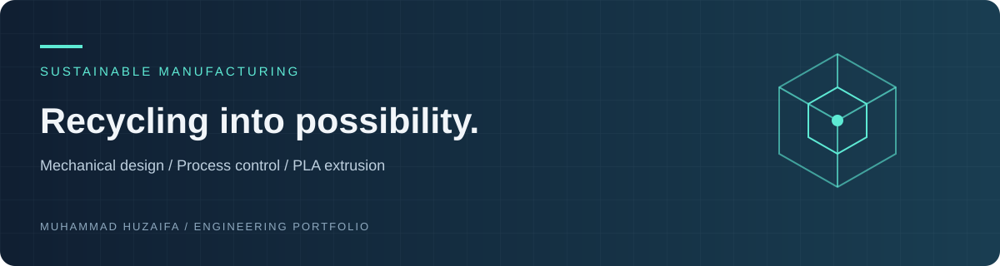

# Recyclable Filament Extrusion Machine

**Design and Development of an Innovative Extrusion Machine for Recyclable Filament**

A final-year industrial engineering project at UET Taxila, Pakistan, exploring how waste PLA can be processed into reusable 3D-printing filament.

## The engineering challenge

Failed prints and discarded filament create material waste. This project developed a compact extrusion prototype that brings together mechanical design, heating, material transport, sensing, and puller-speed control.

## What the project covers

- **Design and fabrication:** concept development, CAD modeling, component selection, manufacturing, and assembly.
- **System integration:** heated barrel, extrusion nozzle, motor-driven pulling mechanism, and sensor-assisted control.
- **Engineering analysis:** CFD, steady-state thermal and structural analysis, alongside prototype testing.
- **Process evaluation:** filament consistency, temperature distribution, and machine stability.

| Design feature | Specification / purpose |
| --- | --- |
| Barrel | 460 mm length; 32 mm outer diameter |
| Nozzle | 1.7 mm |
| Cartridge heaters | 150–200 W |
| Sensing and actuation | 49E Hall-effect sensor; L298N motor driver |
| Dimensional objective | Approximately ±0.05 mm target tolerance |

The tolerance above is a **design target**, not a claim that every trial achieved it. The thesis provides the experimental context and evaluation.

## Explore the work

| Resource | What you will find |
| --- | --- |
| [Project thesis](https://github.com/huzaifaalvi19-source/Final-Year-Design-Project-Thesis-/blob/main/FYDP%20Thesis%20pt.pdf) | Design, analysis, development, and testing |
| [Extrusion parameter optimization](https://github.com/huzaifaalvi19-source/Final-Year-Design-Project-Thesis-/tree/main/Linked%20Semester%20Projects%20with%20FYDP/Design%20of%20Experiment) | Full-factorial DOE, ANOVA, and regression in Minitab |
| [Filament X business concept](https://github.com/huzaifaalvi19-source/Final-Year-Design-Project-Thesis-/tree/main/Linked%20Semester%20Projects%20with%20FYDP/Entrepreneurship) | Circular-economy concept, costing, and business planning |

## Further development

Potential extensions include automated winding, better process monitoring, improved control, and evaluation of other thermoplastics. These are future directions rather than completed features.

---

[Portfolio](https://huzaifaalvi19-source.github.io/Personal-Portfolio/) · [Research](https://github.com/huzaifaalvi19-source/Research-Publications) · [Projects](https://github.com/huzaifaalvi19-source/Selected-Bsc-Industrial-Engineering-Semester-Projects) · [LinkedIn](https://www.linkedin.com/in/muhammad-huzaifa-c1a2t3) · [ORCID](https://orcid.org/0009-0008-8113-1315)
